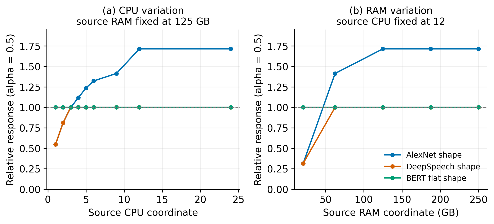
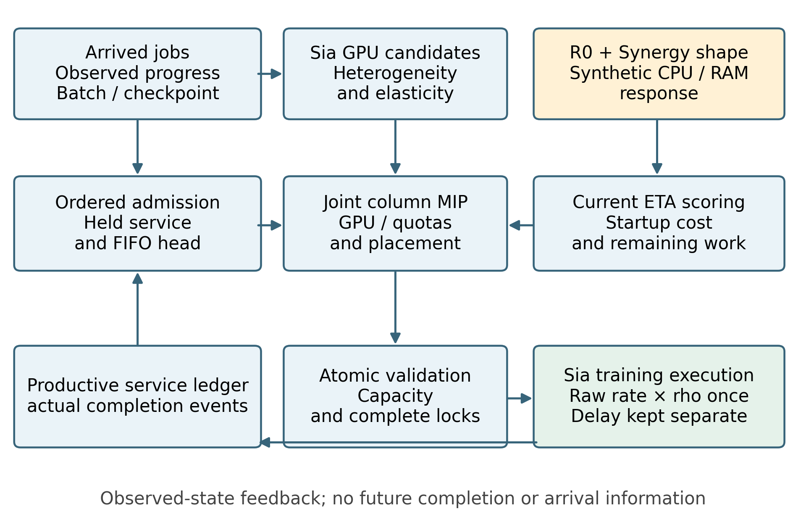

# CC-Joint 算法设计报告

**交付1｜完整机制、流程图、数学公式与伪代码**

## 阅读说明

本报告对应已完成80作业七方法实验的`cc-joint-core80-full-lex-repair-v8`，实际329文件源码快照，而非裸Git HEAD。最新恢复等效版本单列于实验报告，未冒充v8复跑。算法未因本次交付而修改。

研究目标是在异构GPU集群中，同时组织任务服务与GPU/CPU/RAM配置，以降低平均JCT。保留Sia合法异构GPU、弹性数量、batch自适应和Goodput模型；CPU/RAM响应借鉴Synergy公开矩阵，联合有限列MIP是本项目实现，并非直接移植Synergy-TUNE。

主流程为：当前状态 → 合法联合候选 → 性能与ETA查询 → checkpoint/服务约束 → 联合词典序求解 → 独立审计 → 原子提交 → 真实训练与完成反馈。

SYNTHETIC CROSS-HARDWARE TRANSFER — NOT REAL SATURN PERFORMANCE。

## 1 问题定义与性能模型

### 1.1 资源、配置与度量

令节点集合为N，节点n具有GPU、CPU与RAM容量G_n、C_n、M_n。作业j在a_j到达，完成时刻为F_j。一个合法联合候选k包含GPU类型、数量、节点GPU向量g_jkn、每GPU辅助配额c_jk与m_jk，以及当前状态下选出的batch和梯度累积配置。CPU计量使用合成CPU单位，RAM使用GB；它们不是被核验的真实服务器规格。

主要评价指标为平均作业完成时间：

$$
\overline{JCT}=\frac{1}{J}\sum_{j=1}^{J}(F_j-a_j). \qquad (1)
$$

若N(t)为时刻t已到达但未完成的作业数，对有限且全部完成的作业集有：

$$
\sum_j(F_j-a_j)=\int_0^{\infty}N(t)\,dt. \qquad (2)
$$

式(2)说明减少等待和更早完成释放资源都可能降低总JCT，却不意味着最大化单轮吞吐、并发数或当前完成时间倒数就等价于最小化全局JCT。本文使用这些量构造可计算的近似，并通过实际完成事件检验。

### 1.2 统一CPU和内存响应

Sia提供GPU性能和训练推进模型。Synergy公开CPU×RAM矩阵提供响应形状；主实验固定映射CIFAR10→alexnet_1、DeepSpeech2→deepspeech_1、BERT→bert_1。映射是合成迁移，而非这些Saturn任务的同平台测量。特别地，所用BERT矩阵恒为1，只能代表理想低敏感模板，不能据此宣称真实BERT对主机资源不敏感。

R0离线参考注册表覆盖5种应用和11个单节点GPU配置，共55项。以固定参考microbatch下的每GPU吞吐比v_aq构造需求缩放，参考源行、聚合方式和哈希均被冻结：

$$
v_{aq}=\frac{T^0_{aq}/g_q}{\min_{q'}(T^0_{aq'}/g_{q'})},\quad
\phi_c=\min(4,\max(0.5,v_{aq})),\quad
\phi_m=\min(2,\max(0.5,\sqrt{v_{aq}})). \qquad (3)
$$

离线注册表用于定义策略无关的合成需求，不向在线Sia模型注入未来完成结果。令M_a为源矩阵的双线性插值，E为既有E-legacy边界裁剪，固定参考点为每GPU 3 CPU单位、62.5 GB，则执行响应为：

$$
\rho_{aq}(c,m)=\left[\frac{M_a(E(c/\phi_c,m/\phi_m))}{M_a(E(3/\phi_c,62.5/\phi_m))}\right]^{\alpha}. \qquad (4)
$$

Neutral取α=0，Medium取α=0.5。CPU坐标裁剪到[1,24]，RAM坐标到[20.83,250]。分子与分母分别审计越界；覆盖注册表不等于覆盖源矩阵支持域。在主80作业容量下，比例点恰好等于参考点，因此其ρ=1是定义结果，不代表物理上不存在辅助资源瓶颈。

图1展示的是源矩阵形状，尚未施加GPU相关的φ；其数值不能直接当成目标硬件的执行速度。矩阵可能有平台或阈值，不能一概假设平滑凹响应。



图1：依据官方alexnet_1、deepspeech_1和bert_1矩阵重绘，在源参考点归一化并取Medium指数。仅展示源支持域内的形状，不是目标Saturn实测，也不是施加R0迁移后的完整曲线。

### 1.3 训练与时间语义

每个执行片段先消耗真实checkpoint/restore倒计时，再推进训练。记由实际batch、累积步数、梯度统计和GPU性能得到的原始训练率为r_raw，则：

$$
r^{exec}_{jk}=r^{raw}_{jq}\rho_{jq}(c_{jk},m_{jk}),\qquad
\Delta p_j=\int_{\mathrm{productive\ interval}}r^{exec}_{jk}(t)\,dt. \qquad (5)
$$

ρ只施加一次，不乘checkpoint、等待或有效服务秒数。执行器直接记录乘ρ前的速率，不能用effective/ρ反推raw形成循环验证。式(5)是连续表达；实际epoch边界沿用Sia整数秒取整，审计显式记录该残差，不要求跨边界整轮满足无残差比例等式。周期中途到达、完成后的资源释放按实际事件积分。完成作业的时间分解为：

$$
JCT_j=Q_j^{first}+Q_j^{later}+D_j+P_j. \qquad (6)
$$

这里Q表示等待，D表示startup/checkpoint/restore，P表示实际训练秒数；彼此互斥。资源小时是分配量的时间积分，不是CPU实际忙碌率或RAM驻留测量。辅助配额自身变化没有额外加载/迁移代价，这是当前执行模型的限制。

## 2 CC-Joint调度机制

### 2.1 架构与候选构造

图2给出调度闭环。每轮只读取已到达作业及当前训练状态，继承Sia合法GPU配置、rigid/scale-unit限制、direct/projected画像来源以及batch自适应。每个GPU配置扩展成节点placement和CPU/RAM配额列，在同一容量预算内进行选择。



图2：实线为当前状态到原子提交和训练执行的路径；反馈包含实际进度与checkpoint状态。R0只进入合成辅助需求，在线Goodput模型仍使用自身观测。服务承诺与checkpoint锁是两个不同集合。

主版本配额域包含既有CPU/RAM网格、源矩阵斜率变化点的反向映射，以及潜在同类型peer的容量余量点。CPU下限为每GPU 1单位，RAM下限为20.83 GB；所有候选还要经过逐节点容量和历史配置资格过滤。跨节点时要求每GPU辅助配额一致，但本文主实验每GPU类型仅一个节点，并限制单节点合法配置，因此不将其外推为多节点分布式placement验证。

### 2.2 完成导向评分

作业声明总训练工作量为B_j，已完成进度为p_j(t)，剩余w_j(t)=max(0,B_j−p_j(t))。利用当前已观测模型和真实batch估计候选原始训练率，计入本次实际启动或剩余恢复代价d_jk：

$$
\widehat T_{jk}=d_{jk}+\frac{w_j(t)}{\widehat r^{raw}_{jq}\rho_{jq}(c_{jk},m_{jk})},\qquad
u_{jk}=\frac{1}{\widehat T_{jk}}. \qquad (7)
$$

未知ETA不伪造正预测值，主评分为0，并使用共享比例bootstrap候选。bootstrap本身不保证获服务，首次服务还依赖第2.3节的单独可行性检查与队首强制准入。主实验统一seed_profiles(1,8)，未单独证明冷启动性能优势。评分只读取声明工作量、当前进度和已观测性能，不读取未来到达或真实完成时间。不同应用的剩余工作量单位不能直接相加为吞吐；式(7)通过剩余时间作比较。

式(7)假设当前预测速率可作为剩余执行的局部近似，不预测未来所有epoch、其他作业完成后的资源释放或被让出资源的作业未来恢复。因此它不是全局最优JCT求解器。它倾向让相对易完成的任务提前释放资源，但可能低估长作业损失。本文保留这一失效边界，而不把训练进度提高直接解释成完成时间必然改善。

### 2.3 有序启动与持续有效服务

等待队列按真实到达时间、稳定源行和作业标识排序。令H_t为已承诺且尚未完成的作业集，L_t为真实checkpoint锁定作业集。已有承诺必须继续被选择；可行FIFO队首也必须获得准入，其余作业仍可由优化器选择。队首并非永久独占，也不是优化器完全无法选择服务集合。

若队首单独不存在合法配置，则显式报告错误；若其与现有H_t无法共同容纳，则进入排空，仅维持既有服务，不继续给后续作业发放新承诺。可行时，队首进入强制集合。持续有效服务保持到实际完成，不在300秒后自动撤销；300秒服务段只用于历史模式与关闭持续保护的消融。

服务承诺保证继续被选择，但不等于配置永远不变。合法事件、已获得的有效训练、画像可信度和启动预算允许有限调整。完整checkpoint锁更强：必须保留GPU类型/数量、节点placement以及CPU/RAM配额。启动预算累计真实损失，而非仅记切换次数；主版本预算250秒。

在有限作业集、每个作业单独可行、已承诺作业训练率存在正下界、声明工作有限、启动损失有界、求解成功且资源不撤销的条件下，H_t中的作业最终完成；排空时不再增加后续承诺，故被阻塞队首最终可接纳。对队首递推可得有限队列的最终服务。该条件论证不覆盖零速率、画像错误、求解失败或无限过载，也不给出无条件等待时间上界。

### 2.4 联合优化与原子提交

用二元变量x_jk表示为作业j选择候选k。同轮以正数s_t归一化评分，不改变候选排序。主问题为：

$$
\max_x\sum_{j,k}\frac{u_{jk}}{s_t}x_{jk},\qquad x_{jk}\in\{0,1\}. \qquad (8)
$$

每个任务最多一个配置，三种资源逐节点受约束：

$$
\sum_kx_{jk}\leq1,\quad
\sum_{j,k}g_{jkn}x_{jk}\leq G_n,\quad
\sum_{j,k}g_{jkn}c_{jk}x_{jk}\leq C_n,\quad
\sum_{j,k}g_{jkn}m_{jk}x_{jk}\leq M_n. \qquad (9)
$$

对服务强制集合P_t=H_t加可行队首，要求每个作业恰好被选择；对checkpoint锁只保留当前完整分配的重查询列：

$$
\sum_kx_{jk}=1\quad(j\in P_t),\qquad
x_{j,k_j^{old}}=1\quad(j\in L_t). \qquad (10)
$$

正常优化先最大化主效用，再在数值等价带内最小化真实startup总秒数，最后按稳定作业和候选序执行确定性词典序选择。有限列整数规划最坏情况组合复杂度高；候选数量受GPU域、placement和辅助配额笛卡尔积影响，不能将其描述为低成本闭式解。工程实现只接受具有相应求解证明且通过原始约束验收的结果。

提交前独立校验完整三资源容量、checkpoint等式、当前候选资格和Oracle版本。回退若存在，只能复用分配几何和配额，并重算本轮Goodput与ρ；不能提交过期列或部分解。真实锁不可行或不能证明合法时显式失败。

### 2.5 有界收尾与算法流程

主版本的CC-TAIL扩展仅在活动作业剩一个、没有其他等待者、无checkpoint且已有有效训练时，允许一次有界恢复。候选必须在支付真实切换代价后缩短当前预计剩余时间；超出常规启动预算的额外部分至多250秒。恢复后GPU几何冻结，辅助配额仍可调整。它用于避免孤立尾任务因历史预算而长期维持低效配置，不是所有长作业的通用优先保护，也不能消除竞争期已经累积的损失。

```text
算法1  CC-Joint每轮调度
输入：已到达Job状态、节点容量、当前分配、服务账本、固定响应数据
1  由Sia状态枚举合法GPU配置，扩展placement与辅助资源候选
2  用当前性能模型、实际batch与统一ρ计算ETA；过滤配置资格
3  移除已完成承诺；按真实arrival及源行将新作业入队
4  生成完整checkpoint锁；已有服务承诺强制保留
5  检查队首单独可行性和与已承诺集合的共同可行性
6  若共同不可行则排空；否则强制队首，保留其他任务可选
7  联合词典序求解：完成效用 → startup损失 → 稳定择解
8  独立审计容量、锁、当前候选与响应版本；失败则不提交
9  原子提交，先消耗真实延迟，再以raw_rate×ρ推进训练
10  记录完成事件、互斥时间、资源积分与边界裁剪
```


## 3 输入、输出与状态契约

|对象|内容|用途|
|---|---|---|
|Job当前状态|arrival、源行、进度、epoch、batch、已观测profile、当前分配|合法GPU与ETA，不读取未来完成时间|
|节点容量|GPU数、合成CPU单位、RAM GB|逐节点物理容量约束|
|服务账本|waiting队列、held、真实productive秒数、启动损失预算|有序启动、持续服务与排空|
|checkpoint锁|当前完整GPU、placement、CPU/RAM与剩余倒计时|完整等式保护，不能当可选列|
|Oracle|R0 registry、矩阵、phi、参考点、alpha、版本|统一响应查询，分子/分母裁剪分别记账|
|输出|完整allocation、候选来源、ETA、rho、求解状态、审计|只有整体合法才原子提交|

## 4 冷启动、失败和保证边界

未画像ETA不伪造正训练率；候选使用共享比例bootstrap，首次服务还依赖可行队首强制准入。主80作业统一seed_profiles(1,8)，不是完全无画像冷启动实验。

在队列有限、每任务单独可行、真实训练率有正下界、工作量有限、启动损失有界、求解成功及资源不撤销时，已承诺任务完成并释放资源，排空保证被阻塞队首最终可以接纳。零训练率、不可行锁、无限过载和求解失败不在该保证内。

求解无可用解不等于可合法提交空分配。回退必须重建当前轮查询，并独立证明完整容量、候选资格与锁合法；不能证明时停止并记录诊断。不能放松锁来继续运行。

## 5 核心代码地图与复杂度

|文件|职责|
|---|---|
|core80.py|v8组装入口、服务/资源因素、实际Cluster适配|
|completion_time.py|声明工作量、当前raw训练率与ETA|
|completion_continuity.py|完成效用、有效服务账本和条件活性|
|clean_ablation.py|共同候选资格、队首准入、强制集合与稳定择解|
|joint_integration.py / joint_scheduler.py|Sia候选桥接、联合列、placement、容量和原子审计|
|joint_profile.py / r0_liveness.py|Synergy矩阵、固定phi与响应|
|tail_recovery.py|单任务有界收尾恢复|
|job.py / applications.py / goodput.py / sia.py|真实训练推进及继承的Sia模型|
|engineering_repair.py / numeric_repair.py等|正式v8等价数值求解与验收覆盖入口|

候选规模约为任务数×GPU配置数×placement数×辅助资源点数；有限列MIP最坏组合复杂度高。v8主实验求解P99为90.77秒，超过60秒周期；当前仿真没有将计算墙钟注入JCT，不能据此宣称在线部署已满足实时性。

精确函数、行号及版本差异见附带`evidence/algorithm_formalization.md`。主80源码SHA-256为B0DCAEB4A5A205B6CA27893F3ACFE1F43C3F850CA8AF6E5BC79B15029518D6EB。

## 6 当前实现的适用范围

有序启动与持续服务主要控制重复等待；联合资源配置利用差异化响应，但倒数ETA不等价全局平均JCT最优，部分长任务可能受损。CPU/RAM自身配额调整没有额外加载费用。主实验是每GPU类型一个节点、单节点任务候选，不能外推成大规模跨节点验证。

Sia已有重配置惩罚和checkpoint保护，本方法不是补上“原Sia完全没有”的能力。FIFO、服务保护与CPU感知也都存在相关先例，贡献在具体协调机制与独立消融证据。
