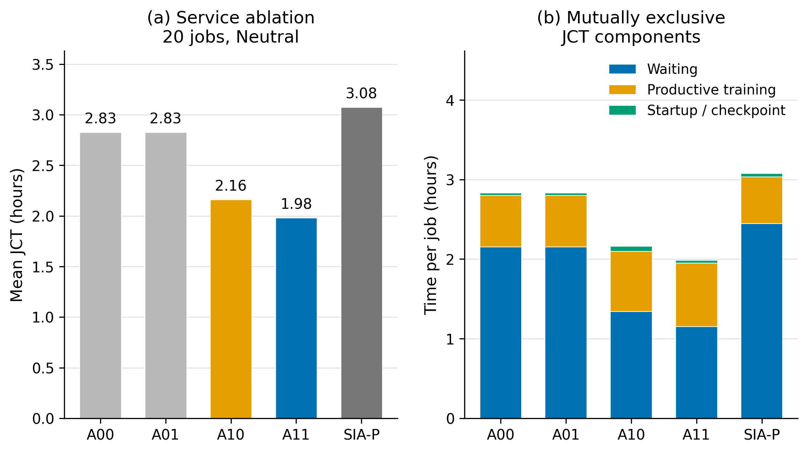
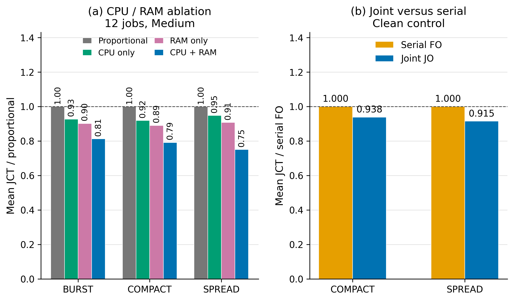
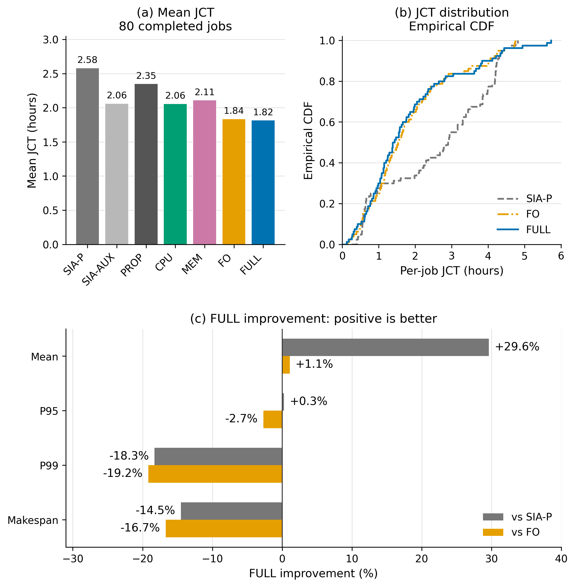
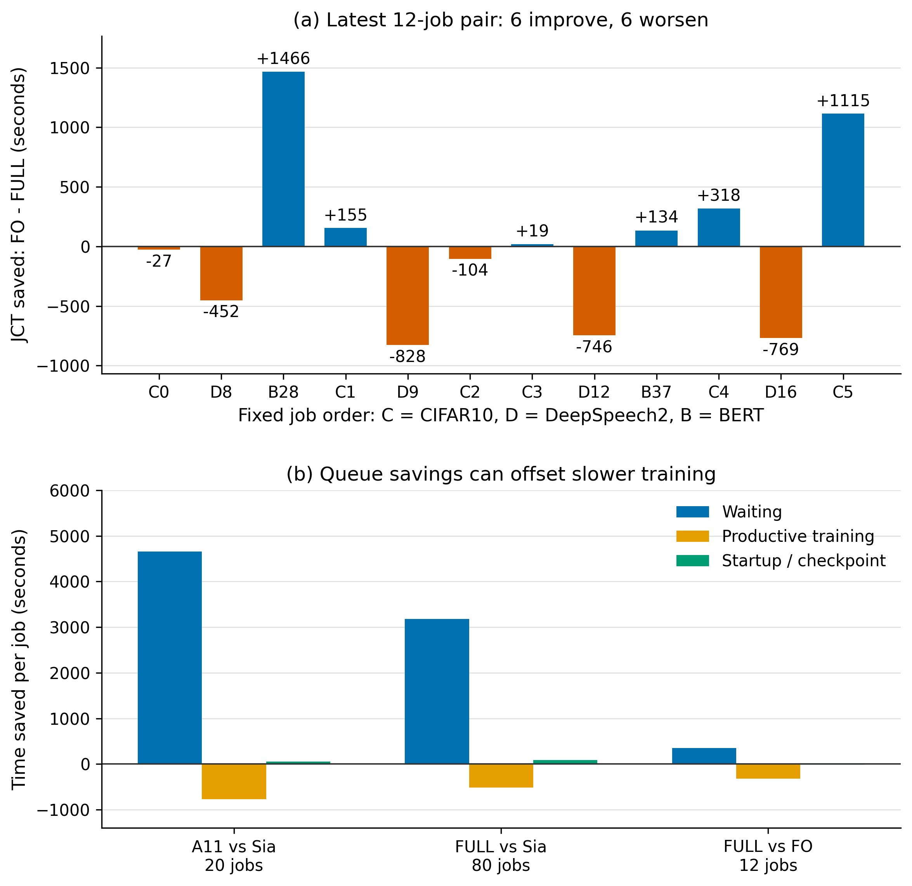

# CC-Joint 完整实验报告

**交付2｜Baseline对照、完整指标表、曲线与逐作业数据**

## 范围与结论

本报告完整收录论文采用的四套已完成证据，共42个实验格：clean_ab 15、arrival18 18、core80 7、最新mixed12 2。不是声称项目历史所有尝试只有42格；未完成、旧失败和其他探索结果仍保存在原research_runs。本次没有启动或重跑训练仿真。

主80作业FULL对官方Sia决策适配基线平均JCT下降29.62%，P99/makespan恶化18.29%/14.50%；对串行FO的均值增量仅1.09%。差异化CPU/RAM在固定合成模型中有效，联合GPU相对串行额外收益依赖负载。后期12作业仅0.336%增量及所有DeepSpeech退化均保留。

所有42格已从逐作业completion-arrival重算聚合，并核对waiting+training+checkpoint=JCT。不同源码组不合并为同一版本的统一效应。不将单次确定性实验的作业当独立重复。

SYNTHETIC CROSS-HARDWARE TRANSFER — NOT REAL SATURN PERFORMANCE。

## 1 实现与实验方法

### 1.1 实现版本与实验层次

论文主实现固定为`cc-joint-core80-full-lex-repair-v8`，源码329文件快照哈希见附录。核心实现为`completion_time.py`的当前ETA预测、`completion_continuity.py`的完成评分与服务账本、`clean_ablation.py`的共同资格和准入、`joint_scheduler.py`的候选/容量/审计、`tail_recovery.py`的收尾扩展以及`job.py`的真实训练推进。源码函数与精确行号另见证据文件。

本报告不把历史版本混合为一次统一实验。表1列出证据层次。作业均保留源应用训练工作量，但受控实验的任务构成、到达序列和部分记录复用是合成设计，并非多条独立真实生产trace。所有对照在各自组内共享负载、容量、画像初始化与执行模型。

|表1 证据组|作业及到达|节点资源|用途与版本限制|
|---|---|---|---|
|服务A|20作业，18 CIFAR+2 DeepSpeech|AWS/DGX各2GPU、6CPU、187.5GB|Neutral；291文件干净消融；共同公平评分，非主方法完整评分|
|资源B|12作业，6 CIFAR+6 BERT；COMPACT/SPREAD|AWS/DGX各2GPU、6CPU、125GB|Medium；共同完成评分与服务规则；固定/联合GPU×比例/辅助优化|
|资源开关|相同12作业；BURST/COMPACT/SPREAD|同资源B|289文件版本；六方法；到达变化不是独立新trace|
|主实验|80作业，48 CIFAR+16 DeepSpeech+16 BERT；40@0、20@600、20@1200秒|AWS4GPU/12CPU/250GB；DGX8/24/500；RTX8/24/500|Medium；v8同版七方法完整配对|
|边界案例|12作业，6 CIFAR+4 DeepSpeech+2 BERT；6@0、6@600秒|AWS4GPU/18CPU/125GB；RTX4/12/375GB|后期344文件恢复等效版，仅作失效边界，不混入主表|

GPU性能来源于官方Artifact相应画像；CPU单位与RAM容量均为合成规格。调度周期60秒，上限6000轮，完成可提前结束。主组均使用相同seed_profiles(1,8)，因此不把结果称为完全无画像冷启动。主实验是单节点作业配置，不代表多节点大规模placement结论。

### 1.2 对照方法

|表2 方法|GPU与服务选择|辅助配额|与FULL的主要差异|
|---|---|---|---|
|SIA-P|实际官方Sia决策和placement；原准入与公平目标|节点GPU比例|外部基线；不加入CC服务机制|
|SIA-AUX|冻结官方完整GPU/placement意图|固定集合辅助优化|服务、GPU及辅助评分均可能不同；非单因素消融|
|CC-PROP|与FULL共享服务和GPU候选|比例|关闭辅助差异化|
|CC-CPU|同FULL|仅CPU自由，RAM比例|CPU独立开关|
|CC-MEM|同FULL|仅RAM自由，CPU比例|RAM独立开关|
|FO|共同控制器先在比例域确定服务集合和GPU，再冻结GPU配置|第二阶段辅助优化，可调整允许的placement|共享完成评分；串行而非联合决策，不是官方Synergy|
|FULL|联合选择GPU、辅助配额与placement|CPU/RAM均自由|主方法CC-Joint|

SIA-AUX在主版本固定集合内使用ETA和目标，FO/FULL使用倒数ETA和，因此FULL对SIA-AUX不是只改变GPU选择。FO是更直接的串行机制对照，但主版本收尾恢复资格存在后来修正的单列限制；最新恢复等效12作业结果另行报告，不假称该修正已被80作业验证。

### 1.3 统计与正确性

本报告从已有逐作业completion−arrival重新计算均值、中位数、线性插值P95/P99与makespan，并核对等待、训练与checkpoint之和。全部纳入图表的配对均完成；未完成历史尝试不填入总体均值。12/20作业分位数仅是描述性经验尾部，不能作为高精度总体估计。多个方法共享作业并不产生独立样本；不为确定性单次运行构造误差棒。

主80作业版本已有335项正确性/工程测试、原始Sia有界精确回归及原始日志审计。本报告重新抽取42格记录并复算聚合值，全部匹配；此处42格是四组论文证据的记录数，不是另一轮历史42格实验。未重跑仿真，也未再次完整扫描全部压缩日志；容量、锁与单次倍率的零违规结论对应已保存的独立原始日志审计。

## 2 实验结果

### 2.1 有序启动和持续服务的作用

图3在共同公平评分和候选契约下比较四个服务单元。A00关闭有序与持续，A01只开持续，A10只开有序，A11同时开启。两种关闭持续的模式使用300秒有效服务段，并保留启动预算安全底线。

图3：20作业Neutral服务消融。A00/A01平均JCT均为10183.20秒，A10为7783.45秒，A11为7137.40秒；实际Sia为11075.75秒。A组目标保持公平评分，因此该图证明服务组织的条件作用，不证明完成优先评分本身的贡献。

有序开启后，持续服务将均值再降低8.30%；有序关闭时持续开关结果相同。有序在持续开启时降低29.91%。令μ_ab为两个因素开关下的均值，交互定义为I=μ_11−μ_10−μ_01+μ_00，负值表示联合开启带来额外下降。本组I=−646.05秒，说明两机制在该负载下互相配合，而非各自都普遍有效。

A11相对Sia平均JCT下降35.56%，总等待减少93180任务秒，训练增加15438任务秒，checkpoint减少1025任务秒，净节省78767任务秒。收益因此主要来自排队结构，而不是每个任务都训练更快。相对于A10，A11首次等待增加66540任务秒，但后续等待减少80400任务秒；“有序启动”不等于所有任务都更早首次启动，而是抑制已启动任务重新陷入等待。A11仍有P99退化，说明这种保护存在长短作业权衡。

### 2.2 CPU和RAM差异化配置的增量

图4左侧使用同一12作业集合的三种到达序列，比较CC-PROP、CPU、MEM、FULL。CPU-only相对比例版本平均JCT下降5.18%–8.11%，RAM-only下降9.30%–10.95%，FULL下降18.72%–24.94%。这些是同一控制器中的资源开关证据，不能等同于FULL对Sia的全部收益。

图4：左侧按各场景CC-PROP归一化，右侧为独立干净资源B组JO相对FO的比较。两边版本和对照目的不同，不合并计算一个效应。无误差棒；三种到达共享作业。

在干净资源B中，COMPACT的FP/JP、FO、JO平均JCT分别为4414.17、3724.67、3494.33秒；SPREAD分别为3647.42、2992.92、2737.58秒。JO对比例JP的改善为20.84%和24.94%，对串行FO的增量仅6.18%和8.53%。FP与JP在比例域下等价，其逐轮一致是负对照。该结果说明辅助差异化本身具有较强作用，而联合GPU选择的额外价值应单独评价。

这组受益依赖固定E-legacy假设。实际混合共驻中，“receiver加速且donor不减速”的时间在COMPACT/SPREAD分别为5776/4080节点秒，但分子、分母均在源支持域内且同时受益的时间均为0。本报告据此只主张合成模型中的机制兑现，不宣称真实CPU/RAM画像被验证。BERT理想平坦模板、参考分母越界与边界延伸均可能放大资源互补。

### 2.3 80作业完整对照

表3给出同版七方法的完整80/80配对。图5同时显示均值、经验分布与尾部，防止仅凭均值掩盖代价。

|表3 方法|平均JCT/s|中位数/s|P95/s|P99/s|Makespan/s|
|---|---:|---:|---:|---:|---:|
|SIA-P|9290.88|10475.50|15778.00|17149.94|18519|
|SIA-AUX|7420.41|6904.00|14505.65|16320.76|16888|
|CC-PROP|8460.56|7426.00|17639.15|18937.84|19516|
|CC-CPU|7408.18|6144.00|16385.85|18783.86|19515|
|CC-MEM|7596.74|6369.00|17509.80|19164.15|19729|
|FO|6610.69|5536.50|15320.50|17021.07|18171|
|FULL|6538.91|5068.00|15735.10|20286.42|21204|

图5：80作业同版完整结果；改善率=(基线−FULL)/基线，正值为改善。经验CDF直接使用逐作业JCT；未将80作业当作80次独立重复。

FULL对SIA-P平均JCT下降29.62%，55个作业改善、25个退化；中位数下降51.62%，P95基本持平，但P99增加18.29%，makespan增加14.50%。因此不能概括为“全部指标均改善”。FULL对CC-PROP下降22.71%，仅CPU/仅RAM开关分别下降12.44%/10.21%。FULL对FO只有1.09%的平均增量，61个作业改善、18个退化、1个相同，少数退化任务抵消了较多作业的节省。

资源积分见表4。FULL相对SIA-P减少19.80% GPU小时、10.90% CPU单位小时及14.46% RAM GB小时，重启数下降25.73%。这些积分不是硬件利用率测量，也不能作为能耗结论。相对FO，FULL虽然使用更少GPU小时，却使用更多CPU/RAM，说明资源代价在不同维度间转移。

|表4 方法|GPU小时|CPU单位小时|RAM GB小时|重启|Wasted GPU秒|
|---|---:|---:|---:|---:|---:|
|SIA-P|99.73|299.18|6232.93|377|30475|
|SIA-AUX|90.51|266.15|5447.46|332|26185|
|CC-PROP|102.51|307.54|6407.01|287|22670|
|CC-CPU|95.29|290.23|5955.33|267|20835|
|CC-MEM|95.49|286.47|6057.93|268|20045|
|FO|83.82|258.02|5265.19|266|20700|
|FULL|79.98|266.58|5331.91|280|18775|

总JCT分解显示，FULL对SIA-P等待减少254640任务秒、checkpoint减少6925任务秒，但有效训练耗时增加41408任务秒，净节省220157任务秒。FULL后续等待为0，SIA-P为110880任务秒。这支持持续服务减少反复排队的解释；同时说明部分任务以较小配置稳定运行，单个任务的训练阶段可能更长。它不是“Sia一般存在缺陷”的证明，而是给定受控资源竞争下的可复现现象。

### 2.4 长尾与收益集中性

对资源B的JO−FO比较，COMPACT最大受益作业cifar10-5节省1605任务秒，全体净节省2764；诊断性去除该作业后仍改善2.98%。SPREAD最大受益bert-28节省6405任务秒，全体净节省仅3064；去掉该作业后其余11作业均值反而恶化12.08%。这不是删除长尾后的新主结果，而是表明联合增量可能集中于少数任务。

图6保留后期恢复等效版本的12作业边界案例。FULL对FO平均仅改善0.336%，6好6坏，4个DeepSpeech2全部退化。等待节省4200任务秒被新增训练3799和checkpoint120任务秒抵消，最终只净省281任务秒；P99和makespan分别恶化5.56%与5.26%。即使存在持续GPU选择差异、部分作业提前完成并释放资源，也不能保证释放收益补偿所有受损长任务。

图6：上部为最新12作业FO−FULL的逐作业JCT节省，负值表示FULL更慢；下部将不同证据组各自的时间差按作业数归一化，仅比较解释结构，不混合版本计算总收益。

### 2.5 正确性和开销

主80作业七方法均正常完成，已有原始日志审计未发现三资源超配、非法checkpoint变化、进度倒退或重复响应倍率。本报告的重新聚合与所有已纳入图表的逐作业记录一致。正确性测试与数据真实性是两回事：这些检查不能验证跨硬件响应假设。

FULL主实验选择开销累计7289.25秒、P99为90.77秒，SIA-P对应约15.41秒和0.091秒。FULL的P99已经超过60秒调度周期，而当前仿真未把求解墙钟注入模拟JCT。因此这些结果是离线调度机制的完成时间比较，不足以证明当前实现可直接实时部署；减少候选冗余或改进等价求解实现是部署前必要工作，但本稿不以未实施优化作结果。

主80作业被选候选的响应裁剪计数中，FULL分子CPU/RAM越界比例为47.39%/26.13%，参考分母CPU/RAM为13.63%/0%；任一点越界为48.00%。SIA-P、FO任一点越界分别为12.60%和53.18%。这些是被选列查询计数比例，不是训练时间加权比例；不同策略选择不同配置会改变比例，但所有策略使用相同裁剪规则。高裁剪率必须与性能结果一起解释。

## 3 讨论与有效性威胁

**适用范围。** 收益最有可能出现在GPU/CPU/RAM共同受限、任务具有不同敏感性、辅助配额变化存在可行互补，而且服务能够持续足够久以支付切换代价的状态。资源充足、所有任务响应相同、固定GPU后的串行优化已解决机会，或长任务损失超过短任务提前释放收益时，额外联合收益可能很小甚至为负。本报告不预设FULL必须在所有场景获胜。

**Sia比较的边界。** SIA-P是真实调用官方GPU决策与placement的统一执行适配，并非未经环境扩展的原版真实集群Sia。原Sia已经有公平目标、重配置惩罚和checkpoint保护。本报告观察到的等待收益不能解释为这些能力不存在，也不能证明Sia在任意trace中有相同损失。

**响应真实性。** 官方矩阵单元、合成应用映射、R0需求缩放和E-legacy边界是不同证据层级。参考分母裁剪可放大比率，平坦模板可形成过于理想的donor。完整注册表并不消除这一问题。投稿版应补充非平坦donor与支持域内响应的独立证据，或把论文明确限定为合成机制研究，而不能将Synergy原集群验证借给本模型。

**目标与长作业。** 倒数ETA代理偏向较短剩余时间，服务承诺和有限恢复又限制后续纠偏。提前完成是否有利于整体还取决于资源释放时机及其他任务损失。本报告没有给出全局最优性证明；有界收尾只处理最后一个活跃任务，无法解决所有竞争期长尾。公平性或尾延迟要求更强的场景需要另行研究，不能用均值下降掩盖个体退化。

**版本与统计。** 主80作业、干净消融和后期边界案例的源码不相同，本报告逐组固定并披露。受控应用组合与到达模式不是独立生产trace，不能把作业数或相同作业的到达变体充当独立重复。少量12/20作业场景用于机制解释，80作业用于更高竞争规模的已有完整证据；均不等同普适生产评估。

**近邻工作与部署。** Nexus等近邻必须进一步全文比较。本报告仅宣称具体机制协调与可复核证据，不以拼接已有概念作为首次性。单节点候选、初始化画像、辅助配额零额外加载成本及高求解开销均限制部署外推，需在投稿前按目标期刊要求补齐或收窄主张。

## 4 全部42格完成结果

下表单位为秒；每格均为全部作业完成，分位数采用逐作业经验分布的线性插值。

### clean_ab / A20

|方法|完成|平均JCT|中位数|P95|P99|Makespan|
|---|---:|---:|---:|---:|---:|---:|
|A00|20/20|10183.20|11083.00|14475.00|14475.00|16875.00|
|A01|20/20|10183.20|11083.00|14475.00|14475.00|16875.00|
|A10|20/20|7783.45|6641.50|16330.45|19058.09|19740.00|
|A11|20/20|7137.40|6580.00|16737.55|17657.91|17888.00|
|A_SIA|20/20|11075.75|12291.50|15546.25|15580.45|17989.00|

### clean_ab / COMPACT

|方法|完成|平均JCT|中位数|P95|P99|Makespan|
|---|---:|---:|---:|---:|---:|---:|
|B_FP|12/12|4414.17|4661.50|6873.75|6889.15|8093.00|
|B_FO|12/12|3724.67|3920.00|5777.50|5790.70|6994.00|
|B_JP|12/12|4414.17|4661.50|6873.75|6889.15|8093.00|
|B_JO|12/12|3494.33|3421.50|6218.40|6417.28|7667.00|
|B_SIA|12/12|4613.83|4887.00|7157.35|7193.87|8403.00|

### clean_ab / SPREAD

|方法|完成|平均JCT|中位数|P95|P99|Makespan|
|---|---:|---:|---:|---:|---:|---:|
|B_FP|12/12|3647.42|3367.00|6697.80|7949.16|8718.00|
|B_FO|12/12|2992.92|2845.00|6077.95|7825.19|8562.00|
|B_JP|12/12|3647.42|3367.00|6697.80|7949.16|8718.00|
|B_JO|12/12|2737.58|2365.00|5267.60|6467.92|7668.00|
|B_SIA|12/12|3364.25|3155.50|5225.60|5229.12|8522.00|

### arrival18 / BURST

|方法|完成|平均JCT|中位数|P95|P99|Makespan|
|---|---:|---:|---:|---:|---:|---:|
|SIA_P|12/12|4891.58|4765.00|8234.00|8383.60|8421.00|
|SIA_AUX|12/12|4554.83|4493.00|7488.05|7747.21|7812.00|
|CC_P|12/12|4914.17|5111.50|8073.75|8089.15|8093.00|
|CC_CPU|12/12|4556.17|4511.00|7604.05|7660.81|7675.00|
|CC_MEM|12/12|4430.67|4386.00|7461.95|7466.79|7468.00|
|CC_FULL|12/12|3994.33|3871.50|7253.40|7584.28|7667.00|

### arrival18 / COMPACT

|方法|完成|平均JCT|中位数|P95|P99|Makespan|
|---|---:|---:|---:|---:|---:|---:|
|SIA_P|12/12|4613.83|4887.00|7157.35|7193.87|8403.00|
|SIA_AUX|12/12|4411.33|4183.50|7430.60|7627.72|8129.00|
|CC_P|12/12|4414.17|4661.50|6873.75|6889.15|8093.00|
|CC_CPU|12/12|4056.17|4145.00|6404.05|6460.81|7675.00|
|CC_MEM|12/12|3930.67|4119.50|6261.95|6266.79|7468.00|
|CC_FULL|12/12|3494.33|3421.50|6218.40|6417.28|7667.00|

### arrival18 / SPREAD

|方法|完成|平均JCT|中位数|P95|P99|Makespan|
|---|---:|---:|---:|---:|---:|---:|
|SIA_P|12/12|3364.25|3155.50|5225.60|5229.12|8522.00|
|SIA_AUX|12/12|3168.50|3414.00|4874.65|4908.53|7840.00|
|CC_P|12/12|3647.42|3367.00|6697.80|7949.16|8718.00|
|CC_CPU|12/12|3458.50|3088.50|6532.80|7916.16|8562.00|
|CC_MEM|12/12|3308.33|3002.00|6258.00|7666.00|8318.00|
|CC_FULL|12/12|2737.58|2365.00|5267.60|6467.92|7668.00|

### core80 / DUAL80

|方法|完成|平均JCT|中位数|P95|P99|Makespan|
|---|---:|---:|---:|---:|---:|---:|
|FULL|80/80|6538.91|5068.00|15735.10|20286.42|21204.00|
|SIA_P|80/80|9290.88|10475.50|15778.00|17149.94|18519.00|
|SIA_AUX|80/80|7420.41|6904.00|14505.65|16320.76|16888.00|
|PROP|80/80|8460.56|7426.00|17639.15|18937.84|19516.00|
|CPU|80/80|7408.18|6144.00|16385.85|18783.86|19515.00|
|MEM|80/80|7596.74|6369.00|17509.80|19164.15|19729.00|
|FO|80/80|6610.69|5536.50|15320.50|17021.07|18171.00|

### mixed12 / MIXED12

|方法|完成|平均JCT|中位数|P95|P99|Makespan|
|---|---:|---:|---:|---:|---:|---:|
|FO|12/12|6970.00|7166.00|12787.00|13781.40|14630.00|
|FULL|12/12|6946.58|5875.50|13543.35|14547.87|15399.00|

## 5 完整数据、复算与原始证据入口

`evidence/all_cells.csv`包含42格的JCT、等待/训练/checkpoint、资源小时、重启和fallback；`evidence/all_jobs.csv`包含每格每个作业的arrival、completion、JCT、等待、训练、checkpoint和资源积分；`evidence/all_comparisons.csv`包含配对差值和高影响作业诊断；完整机器数据为`evidence/paper_results.json`。

原始逐轮日志仍在项目的research_runs，未复制全部约16.4 GiB历史数据，也未改写。每格的原始summary路径、源码快照hash和预注册来源包含在机器数据中。若脱离原项目分享，这些相对独立的数据表可复算表格，原始逐轮日志仍需按来源目录提供。

被纳入图表的曲线由逐作业记录重新绘制，没有复制其他论文的图像或借用其测量数据作为本系统结果。PDF内图号沿用原研究稿，缺图号不表示实验缺失。

本报告重新核验完成事件和时间分解；容量、checkpoint及单次rho零违规结论对应既有独立原始日志审计，未再次全量扫描全部压缩日志。42格的实验条件按各组冻结，不能将三种到达变体当独立生产trace。
