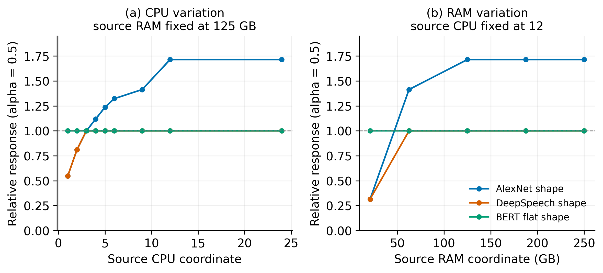
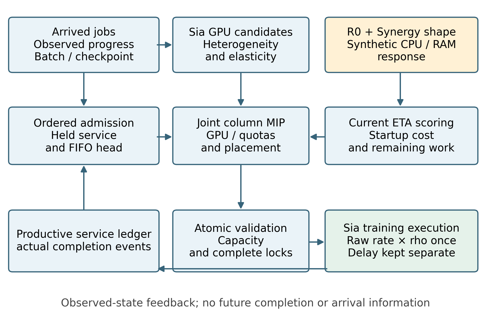
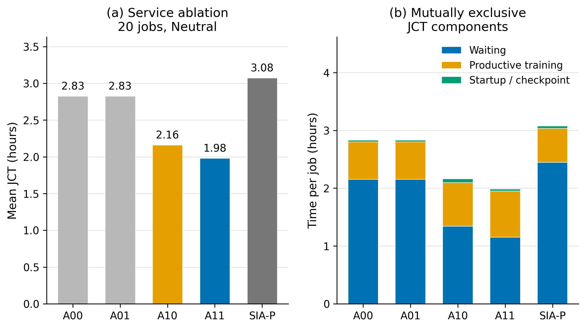
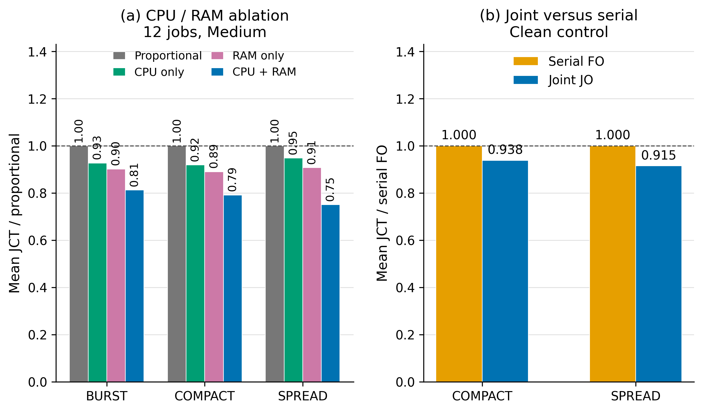
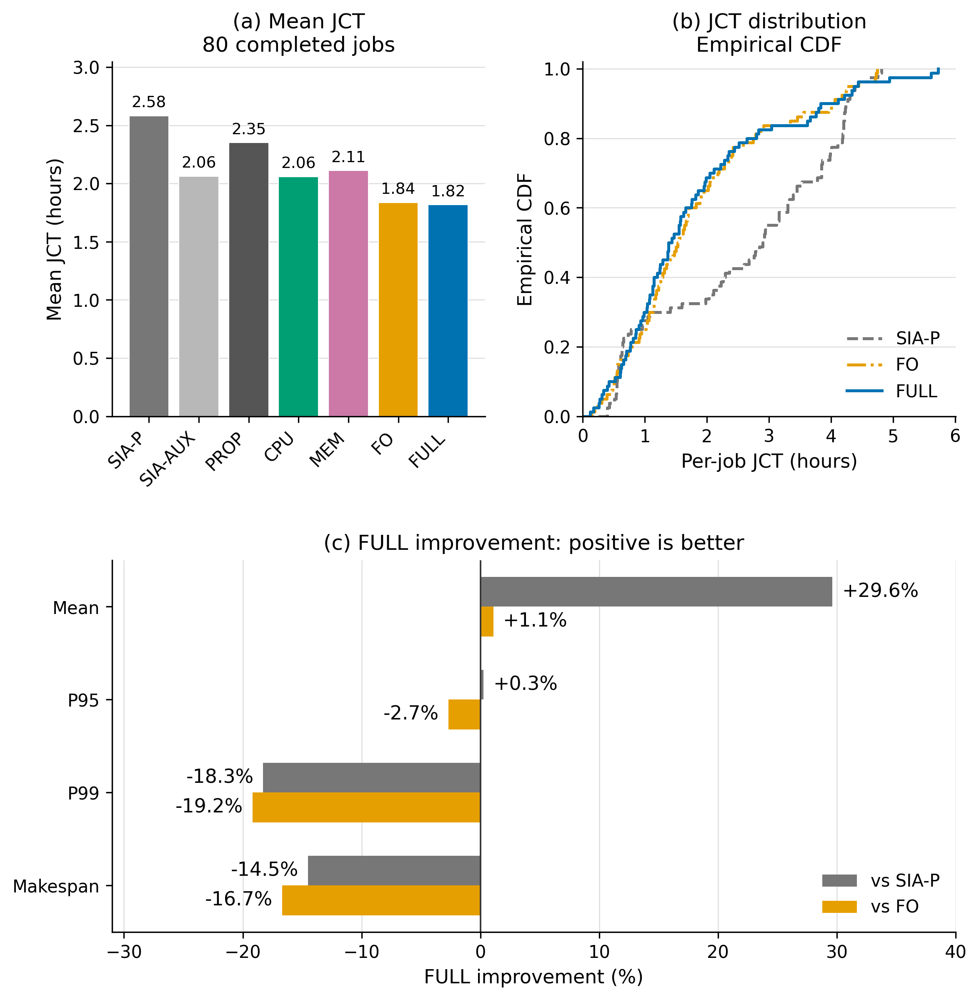
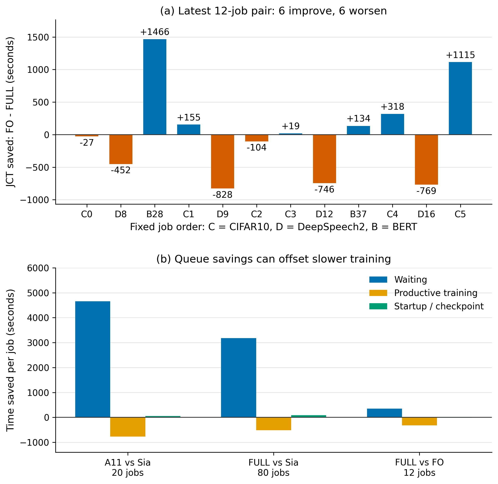

# CC-Joint 面向异构GPU集群的多资源联合调度

**有序启动与持续有效服务机制**

**中文论文初稿 v0.1｜2026-11-01｜基于已完成实验的证据型初稿**

作者、单位、基金与通讯信息由研究者填写。本稿尚未套用目标期刊模板；正文以完成80作业七方法实验的CC-Joint v8为主系统，其他版本单列为机制消融和边界案例，不能将全部数值视为同一最终版本的统一评估。

**数据声明：SYNTHETIC CROSS-HARDWARE TRANSFER — NOT REAL SATURN PERFORMANCE。** 本文GPU训练模型来自Sia Artifact；CPU与主机内存响应形状来自Synergy公开矩阵，应用映射与跨硬件迁移为合成假设。本文报告仿真证据，不报告真实Saturn集群上的联合资源实测性能。

## 摘要

异构GPU集群中的训练速度不仅取决于GPU类型与数量，也受到CPU数据处理和主机内存供给影响。与此同时，周期性弹性配置虽然能够提高单轮训练效率，却未必降低作业的累计排队时间。本文提出CC-Joint，在继承Sia合法异构GPU配置、batch自适应与Goodput模型的基础上，协调有序启动、持续有效服务和CPU/内存差异化分配。该方法以真实到达次序保护可行队首，对已承诺作业维持有效服务，在容量、checkpoint完整锁与启动预算约束下，以当前剩余完成时间的倒数构造有限列联合优化；CPU/内存变化只影响有效训练推进，不缩短恢复延迟。基于冻结源码和统一合成响应模型，80作业完整对照中，CC-Joint相对官方Sia决策逻辑加比例辅助资源的基线平均JCT降低29.62%，GPU占用小时减少19.80%，但P99和makespan分别增加18.29%和14.50%。独立服务消融表明，有序启动与持续服务存在条件交互；资源消融中，联合控制器开放辅助资源优化相对其比例版本降低平均JCT 20.84%和24.94%。联合相对串行优化的额外收益则更小并依赖负载。结果支持两条机制在受控场景下的作用，同时揭示响应边界、长作业代价与调度计算开销仍限制其外推和部署。

**关键词：** 异构GPU调度；作业完成时间；有序准入；持续有效服务；CPU与主机内存；联合资源分配

## 1 引言

共享GPU集群承载的训练作业具有不同的并行扩展效率、batch需求和输入处理开销。给作业增加GPU并不总能带来同比例的有效训练进度：其收益取决于GPU性能、通信与统计效率，也可能受CPU预处理或内存供给限制。Sia和Pollux已将GPU资源与训练自适应联系起来[1–2]；Synergy进一步表明，固定GPU比例分配辅助资源会遗漏作业间不同的资源敏感性[3]。这些工作为多资源调度提供了基础，但将能力组合起来仍需要解决服务组织与资源配置的协同问题。

本文关注两种在资源竞争下同时出现的代价。第一，当前配置的训练效率与最终平均JCT并不等价。某个作业扩容后可能更快，却占用其他作业可用的启动资源；反复改变配置还可能带来checkpoint和恢复开销。Sia已经显式考虑重配置折损和checkpoint保护，本文并不将其描述为忽略成本。我们考察的是：在本文受控负载中，周期公平效用能否充分反映等待累积与服务连续性对平均完成时间的影响。第二，固定GPU意图后的辅助资源优化只能在既定GPU配置内分配CPU/RAM；若不同GPU配置的资源需求和实际速度相互耦合，串行决策可能遗漏可行组合。但这种额外机会不必在每个场景存在，也不必自动转化为JCT收益。

CC-Joint由两条相互配合的机制构成。有序启动和持续有效服务控制哪些作业必须获得连续推进，避免只为了单轮评分反复撤销服务；完成导向的联合配置在同一物理预算内选择GPU、CPU、RAM和placement，使辅助资源无需与GPU固定成比例。本文的贡献不是首次提出异构调度、CPU感知或服务保护，而是给出上述机制在Sia式弹性训练模型中的具体组合、执行语义与可审计证据。

本文主要贡献如下。其一，设计区分checkpoint锁与服务承诺的启动和持续服务机制，并通过共享候选与评分契约的消融识别其条件效果。其二，建立具有可追溯响应来源的完成导向联合配置模型，将辅助资源代价与GPU配置放在同一可行域内。其三，给出完整配对、逐作业时间分解与负结果分析，明确平均JCT收益、尾部代价及合成响应边界，避免以资源维度更多代替有效性证明。

## 2 背景与相关工作

### 2.1 异构性能与训练自适应

Gavel以有效吞吐抽象把不同调度政策映射到异构加速器[4]。Pollux将系统吞吐与统计效率结合为Goodput，联合调整资源和训练配置[2]；Sia扩展到异构GPU类型，并用合法配置和整数优化实现调度[1]。Optimus通过在线资源与进度模型安排训练资源[6]。本文保留Sia的GPU与batch适应能力，但以剩余完成时间代理替换主方法的评分；原始Sia外部基线保持自身目标与决策过程不变。

### 2.2 辅助资源与数据供给

Synergy针对CPU和主机内存敏感性进行资源分配，说明低敏感作业让出资源、敏感作业获得更多资源可以提高集群效率[3]。CoorDL和tf.data从输入流水线层面解释数据读取、预处理、缓存和预取的作用[10–11]；RAP研究推荐模型训练与输入预处理的资源协同[12]。AntMan和Gandiva涉及GPU计算、显存共享或弹性执行，但GPU显存不等同于本文的主机RAM配额[7,9]。Nexus已直接研究资源敏感的异构集群调度[13]，因此本文不宣称“异构GPU与CPU/RAM组合”的首创性。其全文尚待补齐，本文不推定它缺少某项机制。

### 2.3 排队、服务与公平

Tiresias使用已获服务量和离散优先级控制排队与抢占代价[5]；Themis以完成时间公平为目标[8]。这表明排队和服务连续性并非新的问题本身。本文的区别在于：将真实有效训练、完整checkpoint状态与弹性多资源候选共同纳入服务承诺，并用单独的服务消融与辅助资源消融区分贡献。平均JCT并不覆盖所有公平性要求，本文不声称替代Themis式完成时间公平。

## 3 问题定义与性能模型

### 3.1 资源、配置与度量

令节点集合为N，节点n具有GPU、CPU与RAM容量G_n、C_n、M_n。作业j在a_j到达，完成时刻为F_j。一个合法联合候选k包含GPU类型、数量、节点GPU向量g_jkn、每GPU辅助配额c_jk与m_jk，以及当前状态下选出的batch和梯度累积配置。CPU计量使用合成CPU单位，RAM使用GB；它们不是被核验的真实服务器规格。

主要评价指标为平均作业完成时间：

$$
\overline{JCT}=\frac{1}{J}\sum_{j=1}^{J}(F_j-a_j). \qquad (1)
$$

若N(t)为时刻t已到达但未完成的作业数，对有限且全部完成的作业集有：

$$
\sum_j(F_j-a_j)=\int_0^{\infty}N(t)\,dt. \qquad (2)
$$

式(2)说明减少等待和更早完成释放资源都可能降低总JCT，却不意味着最大化单轮吞吐、并发数或当前完成时间倒数就等价于最小化全局JCT。本文使用这些量构造可计算的近似，并通过实际完成事件检验。

### 3.2 统一CPU和内存响应

Sia提供GPU性能和训练推进模型。Synergy公开CPU×RAM矩阵提供响应形状；主实验固定映射CIFAR10→alexnet_1、DeepSpeech2→deepspeech_1、BERT→bert_1。映射是合成迁移，而非这些Saturn任务的同平台测量。特别地，所用BERT矩阵恒为1，只能代表理想低敏感模板，不能据此宣称真实BERT对主机资源不敏感。

R0离线参考注册表覆盖5种应用和11个单节点GPU配置，共55项。以固定参考microbatch下的每GPU吞吐比v_aq构造需求缩放，参考源行、聚合方式和哈希均被冻结：

$$
v_{aq}=\frac{T^0_{aq}/g_q}{\min_{q'}(T^0_{aq'}/g_{q'})},\quad
\phi_c=\min(4,\max(0.5,v_{aq})),\quad
\phi_m=\min(2,\max(0.5,\sqrt{v_{aq}})). \qquad (3)
$$

离线注册表用于定义策略无关的合成需求，不向在线Sia模型注入未来完成结果。令M_a为源矩阵的双线性插值，E为既有E-legacy边界裁剪，固定参考点为每GPU 3 CPU单位、62.5 GB，则执行响应为：

$$
\rho_{aq}(c,m)=\left[\frac{M_a(E(c/\phi_c,m/\phi_m))}{M_a(E(3/\phi_c,62.5/\phi_m))}\right]^{\alpha}. \qquad (4)
$$

Neutral取α=0，Medium取α=0.5。CPU坐标裁剪到[1,24]，RAM坐标到[20.83,250]。分子与分母分别审计越界；覆盖注册表不等于覆盖源矩阵支持域。在主80作业容量下，比例点恰好等于参考点，因此其ρ=1是定义结果，不代表物理上不存在辅助资源瓶颈。

图1展示的是源矩阵形状，尚未施加GPU相关的φ；其数值不能直接当成目标硬件的执行速度。矩阵可能有平台或阈值，不能一概假设平滑凹响应。



图1：依据官方alexnet_1、deepspeech_1和bert_1矩阵重绘，在源参考点归一化并取Medium指数。仅展示源支持域内的形状，不是目标Saturn实测，也不是施加R0迁移后的完整曲线。

### 3.3 训练与时间语义

每个执行片段先消耗真实checkpoint/restore倒计时，再推进训练。记由实际batch、累积步数、梯度统计和GPU性能得到的原始训练率为r_raw，则：

$$
r^{exec}_{jk}=r^{raw}_{jq}\rho_{jq}(c_{jk},m_{jk}),\qquad
\Delta p_j=\int_{\mathrm{productive\ interval}}r^{exec}_{jk}(t)\,dt. \qquad (5)
$$

ρ只施加一次，不乘checkpoint、等待或有效服务秒数。执行器直接记录乘ρ前的速率，不能用effective/ρ反推raw形成循环验证。式(5)是连续表达；实际epoch边界沿用Sia整数秒取整，审计显式记录该残差，不要求跨边界整轮满足无残差比例等式。周期中途到达、完成后的资源释放按实际事件积分。完成作业的时间分解为：

$$
JCT_j=Q_j^{first}+Q_j^{later}+D_j+P_j. \qquad (6)
$$

这里Q表示等待，D表示startup/checkpoint/restore，P表示实际训练秒数；彼此互斥。资源小时是分配量的时间积分，不是CPU实际忙碌率或RAM驻留测量。辅助配额自身变化没有额外加载/迁移代价，这是当前执行模型的限制。

## 4 CC-Joint调度机制

### 4.1 架构与候选构造

图2给出调度闭环。每轮只读取已到达作业及当前训练状态，继承Sia合法GPU配置、rigid/scale-unit限制、direct/projected画像来源以及batch自适应。每个GPU配置扩展成节点placement和CPU/RAM配额列，在同一容量预算内进行选择。



图2：实线为当前状态到原子提交和训练执行的路径；反馈包含实际进度与checkpoint状态。R0只进入合成辅助需求，在线Goodput模型仍使用自身观测。服务承诺与checkpoint锁是两个不同集合。

主版本配额域包含既有CPU/RAM网格、源矩阵斜率变化点的反向映射，以及潜在同类型peer的容量余量点。CPU下限为每GPU 1单位，RAM下限为20.83 GB；所有候选还要经过逐节点容量和历史配置资格过滤。跨节点时要求每GPU辅助配额一致，但本文主实验每GPU类型仅一个节点，并限制单节点合法配置，因此不将其外推为多节点分布式placement验证。

### 4.2 完成导向评分

作业声明总训练工作量为B_j，已完成进度为p_j(t)，剩余w_j(t)=max(0,B_j−p_j(t))。利用当前已观测模型和真实batch估计候选原始训练率，计入本次实际启动或剩余恢复代价d_jk：

$$
\widehat T_{jk}=d_{jk}+\frac{w_j(t)}{\widehat r^{raw}_{jq}\rho_{jq}(c_{jk},m_{jk})},\qquad
u_{jk}=\frac{1}{\widehat T_{jk}}. \qquad (7)
$$

未知ETA不伪造正预测值，主评分为0，并使用共享比例bootstrap候选。bootstrap本身不保证获服务，首次服务还依赖第4.3节的单独可行性检查与队首强制准入。主实验统一seed_profiles(1,8)，未单独证明冷启动性能优势。评分只读取声明工作量、当前进度和已观测性能，不读取未来到达或真实完成时间。不同应用的剩余工作量单位不能直接相加为吞吐；式(7)通过剩余时间作比较。

式(7)假设当前预测速率可作为剩余执行的局部近似，不预测未来所有epoch、其他作业完成后的资源释放或被让出资源的作业未来恢复。因此它不是全局最优JCT求解器。它倾向让相对易完成的任务提前释放资源，但可能低估长作业损失。本文保留这一失效边界，而不把训练进度提高直接解释成完成时间必然改善。

### 4.3 有序启动与持续有效服务

等待队列按真实到达时间、稳定源行和作业标识排序。令H_t为已承诺且尚未完成的作业集，L_t为真实checkpoint锁定作业集。已有承诺必须继续被选择；可行FIFO队首也必须获得准入，其余作业仍可由优化器选择。队首并非永久独占，也不是优化器完全无法选择服务集合。

若队首单独不存在合法配置，则显式报告错误；若其与现有H_t无法共同容纳，则进入排空，仅维持既有服务，不继续给后续作业发放新承诺。可行时，队首进入强制集合。持续有效服务保持到实际完成，不在300秒后自动撤销；300秒服务段只用于历史模式与关闭持续保护的消融。

服务承诺保证继续被选择，但不等于配置永远不变。合法事件、已获得的有效训练、画像可信度和启动预算允许有限调整。完整checkpoint锁更强：必须保留GPU类型/数量、节点placement以及CPU/RAM配额。启动预算累计真实损失，而非仅记切换次数；主版本预算250秒。

在有限作业集、每个作业单独可行、已承诺作业训练率存在正下界、声明工作有限、启动损失有界、求解成功且资源不撤销的条件下，H_t中的作业最终完成；排空时不再增加后续承诺，故被阻塞队首最终可接纳。对队首递推可得有限队列的最终服务。该条件论证不覆盖零速率、画像错误、求解失败或无限过载，也不给出无条件等待时间上界。

### 4.4 联合优化与原子提交

用二元变量x_jk表示为作业j选择候选k。同轮以正数s_t归一化评分，不改变候选排序。主问题为：

$$
\max_x\sum_{j,k}\frac{u_{jk}}{s_t}x_{jk},\qquad x_{jk}\in\{0,1\}. \qquad (8)
$$

每个任务最多一个配置，三种资源逐节点受约束：

$$
\sum_kx_{jk}\leq1,\quad
\sum_{j,k}g_{jkn}x_{jk}\leq G_n,\quad
\sum_{j,k}g_{jkn}c_{jk}x_{jk}\leq C_n,\quad
\sum_{j,k}g_{jkn}m_{jk}x_{jk}\leq M_n. \qquad (9)
$$

对服务强制集合P_t=H_t加可行队首，要求每个作业恰好被选择；对checkpoint锁只保留当前完整分配的重查询列：

$$
\sum_kx_{jk}=1\quad(j\in P_t),\qquad
x_{j,k_j^{old}}=1\quad(j\in L_t). \qquad (10)
$$

正常优化先最大化主效用，再在数值等价带内最小化真实startup总秒数，最后按稳定作业和候选序执行确定性词典序选择。有限列整数规划最坏情况组合复杂度高；候选数量受GPU域、placement和辅助配额笛卡尔积影响，不能将其描述为低成本闭式解。工程实现只接受具有相应求解证明且通过原始约束验收的结果。

提交前独立校验完整三资源容量、checkpoint等式、当前候选资格和Oracle版本。回退若存在，只能复用分配几何和配额，并重算本轮Goodput与ρ；不能提交过期列或部分解。真实锁不可行或不能证明合法时显式失败。

### 4.5 有界收尾与算法流程

主版本的CC-TAIL扩展仅在活动作业剩一个、没有其他等待者、无checkpoint且已有有效训练时，允许一次有界恢复。候选必须在支付真实切换代价后缩短当前预计剩余时间；超出常规启动预算的额外部分至多250秒。恢复后GPU几何冻结，辅助配额仍可调整。它用于避免孤立尾任务因历史预算而长期维持低效配置，不是所有长作业的通用优先保护，也不能消除竞争期已经累积的损失。

```text
算法1  CC-Joint每轮调度
输入：已到达Job状态、节点容量、当前分配、服务账本、固定响应数据
1  由Sia状态枚举合法GPU配置，扩展placement与辅助资源候选
2  用当前性能模型、实际batch与统一ρ计算ETA；过滤配置资格
3  移除已完成承诺；按真实arrival及源行将新作业入队
4  生成完整checkpoint锁；已有服务承诺强制保留
5  检查队首单独可行性和与已承诺集合的共同可行性
6  若共同不可行则排空；否则强制队首，保留其他任务可选
7  联合词典序求解：完成效用 → startup损失 → 稳定择解
8  独立审计容量、锁、当前候选与响应版本；失败则不提交
9  原子提交，先消耗真实延迟，再以raw_rate×ρ推进训练
10  记录完成事件、互斥时间、资源积分与边界裁剪
```

## 5 实现与实验方法

### 5.1 实现版本与实验层次

论文主实现固定为`cc-joint-core80-full-lex-repair-v8`，源码329文件快照哈希见附录。核心实现为`completion_time.py`的当前ETA预测、`completion_continuity.py`的完成评分与服务账本、`clean_ablation.py`的共同资格和准入、`joint_scheduler.py`的候选/容量/审计、`tail_recovery.py`的收尾扩展以及`job.py`的真实训练推进。源码函数与精确行号另见证据文件。

本文不把历史版本混合为一次统一实验。表1列出证据层次。作业均保留源应用训练工作量，但受控实验的任务构成、到达序列和部分记录复用是合成设计，并非多条独立真实生产trace。所有对照在各自组内共享负载、容量、画像初始化与执行模型。

|表1 证据组|作业及到达|节点资源|用途与版本限制|
|---|---|---|---|
|服务A|20作业，18 CIFAR+2 DeepSpeech|AWS/DGX各2GPU、6CPU、187.5GB|Neutral；291文件干净消融；共同公平评分，非主方法完整评分|
|资源B|12作业，6 CIFAR+6 BERT；COMPACT/SPREAD|AWS/DGX各2GPU、6CPU、125GB|Medium；共同完成评分与服务规则；固定/联合GPU×比例/辅助优化|
|资源开关|相同12作业；BURST/COMPACT/SPREAD|同资源B|289文件版本；六方法；到达变化不是独立新trace|
|主实验|80作业，48 CIFAR+16 DeepSpeech+16 BERT；40@0、20@600、20@1200秒|AWS4GPU/12CPU/250GB；DGX8/24/500；RTX8/24/500|Medium；v8同版七方法完整配对|
|边界案例|12作业，6 CIFAR+4 DeepSpeech+2 BERT；6@0、6@600秒|AWS4GPU/18CPU/125GB；RTX4/12/375GB|后期344文件恢复等效版，仅作失效边界，不混入主表|

GPU性能来源于官方Artifact相应画像；CPU单位与RAM容量均为合成规格。调度周期60秒，上限6000轮，完成可提前结束。主组均使用相同seed_profiles(1,8)，因此不把结果称为完全无画像冷启动。主实验是单节点作业配置，不代表多节点大规模placement结论。

### 5.2 对照方法

|表2 方法|GPU与服务选择|辅助配额|与FULL的主要差异|
|---|---|---|---|
|SIA-P|实际官方Sia决策和placement；原准入与公平目标|节点GPU比例|外部基线；不加入CC服务机制|
|SIA-AUX|冻结官方完整GPU/placement意图|固定集合辅助优化|服务、GPU及辅助评分均可能不同；非单因素消融|
|CC-PROP|与FULL共享服务和GPU候选|比例|关闭辅助差异化|
|CC-CPU|同FULL|仅CPU自由，RAM比例|CPU独立开关|
|CC-MEM|同FULL|仅RAM自由，CPU比例|RAM独立开关|
|FO|共同控制器先在比例域确定服务集合和GPU，再冻结GPU配置|第二阶段辅助优化，可调整允许的placement|共享完成评分；串行而非联合决策，不是官方Synergy|
|FULL|联合选择GPU、辅助配额与placement|CPU/RAM均自由|主方法CC-Joint|

SIA-AUX在主版本固定集合内使用ETA和目标，FO/FULL使用倒数ETA和，因此FULL对SIA-AUX不是只改变GPU选择。FO是更直接的串行机制对照，但主版本收尾恢复资格存在后来修正的单列限制；最新恢复等效12作业结果另行报告，不假称该修正已被80作业验证。

### 5.3 统计与正确性

本文从已有逐作业completion−arrival重新计算均值、中位数、线性插值P95/P99与makespan，并核对等待、训练与checkpoint之和。全部纳入图表的配对均完成；未完成历史尝试不填入总体均值。12/20作业分位数仅是描述性经验尾部，不能作为高精度总体估计。多个方法共享作业并不产生独立样本；不为确定性单次运行构造误差棒。

主80作业版本已有335项正确性/工程测试、原始Sia有界精确回归及原始日志审计。本文重新抽取42格记录并复算聚合值，全部匹配；此处42格是四组论文证据的记录数，不是另一轮历史42格实验。未重跑仿真，也未再次完整扫描全部压缩日志；容量、锁与单次倍率的零违规结论对应已保存的独立原始日志审计。

## 6 实验结果

### 6.1 有序启动和持续服务的作用

图3在共同公平评分和候选契约下比较四个服务单元。A00关闭有序与持续，A01只开持续，A10只开有序，A11同时开启。两种关闭持续的模式使用300秒有效服务段，并保留启动预算安全底线。



图3：20作业Neutral服务消融。A00/A01平均JCT均为10183.20秒，A10为7783.45秒，A11为7137.40秒；实际Sia为11075.75秒。A组目标保持公平评分，因此该图证明服务组织的条件作用，不证明完成优先评分本身的贡献。

有序开启后，持续服务将均值再降低8.30%；有序关闭时持续开关结果相同。有序在持续开启时降低29.91%。令μ_ab为两个因素开关下的均值，交互定义为I=μ_11−μ_10−μ_01+μ_00，负值表示联合开启带来额外下降。本组I=−646.05秒，说明两机制在该负载下互相配合，而非各自都普遍有效。

A11相对Sia平均JCT下降35.56%，总等待减少93180任务秒，训练增加15438任务秒，checkpoint减少1025任务秒，净节省78767任务秒。收益因此主要来自排队结构，而不是每个任务都训练更快。相对于A10，A11首次等待增加66540任务秒，但后续等待减少80400任务秒；“有序启动”不等于所有任务都更早首次启动，而是抑制已启动任务重新陷入等待。A11仍有P99退化，说明这种保护存在长短作业权衡。

### 6.2 CPU和RAM差异化配置的增量

图4左侧使用同一12作业集合的三种到达序列，比较CC-PROP、CPU、MEM、FULL。CPU-only相对比例版本平均JCT下降5.18%–8.11%，RAM-only下降9.30%–10.95%，FULL下降18.72%–24.94%。这些是同一控制器中的资源开关证据，不能等同于FULL对Sia的全部收益。



图4：左侧按各场景CC-PROP归一化，右侧为独立干净资源B组JO相对FO的比较。两边版本和对照目的不同，不合并计算一个效应。无误差棒；三种到达共享作业。

在干净资源B中，COMPACT的FP/JP、FO、JO平均JCT分别为4414.17、3724.67、3494.33秒；SPREAD分别为3647.42、2992.92、2737.58秒。JO对比例JP的改善为20.84%和24.94%，对串行FO的增量仅6.18%和8.53%。FP与JP在比例域下等价，其逐轮一致是负对照。该结果说明辅助差异化本身具有较强作用，而联合GPU选择的额外价值应单独评价。

这组受益依赖固定E-legacy假设。实际混合共驻中，“receiver加速且donor不减速”的时间在COMPACT/SPREAD分别为5776/4080节点秒，但分子、分母均在源支持域内且同时受益的时间均为0。本文据此只主张合成模型中的机制兑现，不宣称真实CPU/RAM画像被验证。BERT理想平坦模板、参考分母越界与边界延伸均可能放大资源互补。

### 6.3 80作业完整对照

表3给出同版七方法的完整80/80配对。图5同时显示均值、经验分布与尾部，防止仅凭均值掩盖代价。

|表3 方法|平均JCT/s|中位数/s|P95/s|P99/s|Makespan/s|
|---|---:|---:|---:|---:|---:|
|SIA-P|9290.88|10475.50|15778.00|17149.94|18519|
|SIA-AUX|7420.41|6904.00|14505.65|16320.76|16888|
|CC-PROP|8460.56|7426.00|17639.15|18937.84|19516|
|CC-CPU|7408.18|6144.00|16385.85|18783.86|19515|
|CC-MEM|7596.74|6369.00|17509.80|19164.15|19729|
|FO|6610.69|5536.50|15320.50|17021.07|18171|
|FULL|6538.91|5068.00|15735.10|20286.42|21204|



图5：80作业同版完整结果；改善率=(基线−FULL)/基线，正值为改善。经验CDF直接使用逐作业JCT；未将80作业当作80次独立重复。

FULL对SIA-P平均JCT下降29.62%，55个作业改善、25个退化；中位数下降51.62%，P95基本持平，但P99增加18.29%，makespan增加14.50%。因此不能概括为“全部指标均改善”。FULL对CC-PROP下降22.71%，仅CPU/仅RAM开关分别下降12.44%/10.21%。FULL对FO只有1.09%的平均增量，61个作业改善、18个退化、1个相同，少数退化任务抵消了较多作业的节省。

资源积分见表4。FULL相对SIA-P减少19.80% GPU小时、10.90% CPU单位小时及14.46% RAM GB小时，重启数下降25.73%。这些积分不是硬件利用率测量，也不能作为能耗结论。相对FO，FULL虽然使用更少GPU小时，却使用更多CPU/RAM，说明资源代价在不同维度间转移。

|表4 方法|GPU小时|CPU单位小时|RAM GB小时|重启|Wasted GPU秒|
|---|---:|---:|---:|---:|---:|
|SIA-P|99.73|299.18|6232.93|377|30475|
|SIA-AUX|90.51|266.15|5447.46|332|26185|
|CC-PROP|102.51|307.54|6407.01|287|22670|
|CC-CPU|95.29|290.23|5955.33|267|20835|
|CC-MEM|95.49|286.47|6057.93|268|20045|
|FO|83.82|258.02|5265.19|266|20700|
|FULL|79.98|266.58|5331.91|280|18775|

总JCT分解显示，FULL对SIA-P等待减少254640任务秒、checkpoint减少6925任务秒，但有效训练耗时增加41408任务秒，净节省220157任务秒。FULL后续等待为0，SIA-P为110880任务秒。这支持持续服务减少反复排队的解释；同时说明部分任务以较小配置稳定运行，单个任务的训练阶段可能更长。它不是“Sia一般存在缺陷”的证明，而是给定受控资源竞争下的可复现现象。

### 6.4 长尾与收益集中性

对资源B的JO−FO比较，COMPACT最大受益作业cifar10-5节省1605任务秒，全体净节省2764；诊断性去除该作业后仍改善2.98%。SPREAD最大受益bert-28节省6405任务秒，全体净节省仅3064；去掉该作业后其余11作业均值反而恶化12.08%。这不是删除长尾后的新主结果，而是表明联合增量可能集中于少数任务。

图6保留后期恢复等效版本的12作业边界案例。FULL对FO平均仅改善0.336%，6好6坏，4个DeepSpeech2全部退化。等待节省4200任务秒被新增训练3799和checkpoint120任务秒抵消，最终只净省281任务秒；P99和makespan分别恶化5.56%与5.26%。即使存在持续GPU选择差异、部分作业提前完成并释放资源，也不能保证释放收益补偿所有受损长任务。



图6：左侧为最新12作业FO−FULL的逐作业JCT节省，负值表示FULL更慢；右侧将不同证据组各自的时间差按作业数归一化，仅比较解释结构，不混合版本计算总收益。

### 6.5 正确性和开销

主80作业七方法均正常完成，已有原始日志审计未发现三资源超配、非法checkpoint变化、进度倒退或重复响应倍率。本文的重新聚合与所有已纳入图表的逐作业记录一致。正确性测试与数据真实性是两回事：这些检查不能验证跨硬件响应假设。

FULL主实验选择开销累计7289.25秒、P99为90.77秒，SIA-P对应约15.41秒和0.091秒。FULL的P99已经超过60秒调度周期，而当前仿真未把求解墙钟注入模拟JCT。因此这些结果是离线调度机制的完成时间比较，不足以证明当前实现可直接实时部署；减少候选冗余或改进等价求解实现是部署前必要工作，但本稿不以未实施优化作结果。

主80作业被选候选的响应裁剪计数中，FULL分子CPU/RAM越界比例为47.39%/26.13%，参考分母CPU/RAM为13.63%/0%；任一点越界为48.00%。SIA-P、FO任一点越界分别为12.60%和53.18%。这些是被选列查询计数比例，不是训练时间加权比例；不同策略选择不同配置会改变比例，但所有策略使用相同裁剪规则。高裁剪率必须与性能结果一起解释。

## 7 讨论与有效性威胁

**适用范围。** 收益最有可能出现在GPU/CPU/RAM共同受限、任务具有不同敏感性、辅助配额变化存在可行互补，而且服务能够持续足够久以支付切换代价的状态。资源充足、所有任务响应相同、固定GPU后的串行优化已解决机会，或长任务损失超过短任务提前释放收益时，额外联合收益可能很小甚至为负。本文不预设FULL必须在所有场景获胜。

**Sia比较的边界。** SIA-P是真实调用官方GPU决策与placement的统一执行适配，并非未经环境扩展的原版真实集群Sia。原Sia已经有公平目标、重配置惩罚和checkpoint保护。本文观察到的等待收益不能解释为这些能力不存在，也不能证明Sia在任意trace中有相同损失。

**响应真实性。** 官方矩阵单元、合成应用映射、R0需求缩放和E-legacy边界是不同证据层级。参考分母裁剪可放大比率，平坦模板可形成过于理想的donor。完整注册表并不消除这一问题。投稿版应补充非平坦donor与支持域内响应的独立证据，或把论文明确限定为合成机制研究，而不能将Synergy原集群验证借给本模型。

**目标与长作业。** 倒数ETA代理偏向较短剩余时间，服务承诺和有限恢复又限制后续纠偏。提前完成是否有利于整体还取决于资源释放时机及其他任务损失。本文没有给出全局最优性证明；有界收尾只处理最后一个活跃任务，无法解决所有竞争期长尾。公平性或尾延迟要求更强的场景需要另行研究，不能用均值下降掩盖个体退化。

**版本与统计。** 主80作业、干净消融和后期边界案例的源码不相同，本文逐组固定并披露。受控应用组合与到达模式不是独立生产trace，不能把作业数或相同作业的到达变体充当独立重复。少量12/20作业场景用于机制解释，80作业用于更高竞争规模的已有完整证据；均不等同普适生产评估。

**近邻工作与部署。** Nexus等近邻必须进一步全文比较。本文仅宣称具体机制协调与可复核证据，不以拼接已有概念作为首次性。单节点候选、初始化画像、辅助配额零额外加载成本及高求解开销均限制部署外推，需在投稿前按目标期刊要求补齐或收窄主张。

## 8 结论

本文提出并实现CC-Joint，将有序启动、持续有效服务与完成导向多资源配置引入Sia式异构弹性训练模拟。在已完成的80作业统一对照中，其平均JCT比SIA-P降低29.62%，主要源于等待和无效切换减少；独立资源消融进一步支持CPU/RAM差异化分配在固定合成模型中的增量作用。联合相对串行的额外收益较小且依赖负载，尾部和makespan可能恶化。当前成果为协调服务组织与资源敏感性提供了可解释的模拟证据，而非真实Saturn性能、普遍优越性或全局最优性的证明。

## 参考文献

参考文献编号对应文献汇编，书目由公开出版方/作者来源核验；未取得全文的[12–13]仅用于已核实问题范围，不推断其内部算法。

[1] Suhas Jayaram Subramanya, Daiyaan Arfeen, Shouxu Lin, et al.. Sia: Heterogeneity-aware, goodput-optimized ML-cluster scheduling[C]. SOSP, 2023: 642–657. [出版方/作者来源](https://suhasjs.github.io/publication/sia-sosp23). DOI: 10.1145/3600006.3613175.

[2] Aurick Qiao, Sang Keun Choe, Suhas Jayaram Subramanya, et al.. Pollux: Co-adaptive Cluster Scheduling for Goodput-Optimized Deep Learning[C]. OSDI, 2021: 1–18. [出版方/作者来源](https://www.usenix.org/conference/osdi21/presentation/qiao).

[3] Jayashree Mohan, Amar Phanishayee, Janardhan Kulkarni, et al.. Looking Beyond GPUs for DNN Scheduling on Multi-Tenant Clusters[C]. OSDI, 2022: 579–596. [出版方/作者来源](https://www.usenix.org/conference/osdi22/presentation/mohan).

[4] Deepak Narayanan, Keshav Santhanam, Fiodar Kazhamiaka, et al.. Heterogeneity-Aware Cluster Scheduling Policies for Deep Learning Workloads[C]. OSDI, 2020: 481–498. [出版方/作者来源](https://www.usenix.org/conference/osdi20/presentation/narayanan-deepak).

[5] Juncheng Gu, Mosharaf Chowdhury, Kang G. Shin, et al.. Tiresias: A GPU Cluster Manager for Distributed Deep Learning[C]. NSDI, 2019: 485-500. [出版方/作者来源](https://www.usenix.org/conference/nsdi19/presentation/gu).

[6] Yanghua Peng, Yixin Bao, Yangrui Chen, et al.. Optimus: An Efficient Dynamic Resource Scheduler for Deep Learning Clusters[C]. EuroSys, 2018: 3:1-3:14. [出版方/作者来源](https://doi.org/10.1145/3190508.3190517). DOI: 10.1145/3190508.3190517.

[7] Wencong Xiao, Romil Bhardwaj, Ramachandran Ramjee, et al.. Gandiva: Introspective Cluster Scheduling for Deep Learning[C]. OSDI, 2018: 595-610. [出版方/作者来源](https://www.usenix.org/conference/osdi18/presentation/xiao).

[8] Kshiteej Mahajan, Arjun Balasubramanian, Arjun Singhvi, et al.. Themis: Fair and Efficient GPU Cluster Scheduling[C]. NSDI, 2020: 289-304. [出版方/作者来源](https://www.usenix.org/conference/nsdi20/presentation/mahajan).

[9] Wencong Xiao, Shiru Ren, Yong Li, et al.. AntMan: Dynamic Scaling on GPU Clusters for Deep Learning[C]. OSDI, 2020: 533-548. [出版方/作者来源](https://www.usenix.org/conference/osdi20/presentation/xiao).

[10] Jayashree Mohan, Amar Phanishayee, Ashish Raniwala, et al.. Analyzing and Mitigating Data Stalls in DNN Training[J]. Proceedings of the VLDB Endowment, 2021, 14(5): 771-784. [出版方/作者来源](https://doi.org/10.14778/3446095.3446100). DOI: 10.14778/3446095.3446100.

[11] Derek G. Murray, Jiří Šimša, Ana Klimovic, et al.. tf.data: A Machine Learning Data Processing Framework[J]. Proceedings of the VLDB Endowment, 2021, 14(12): 2945-2958. [出版方/作者来源](https://doi.org/10.14778/3476311.3476374). DOI: 10.14778/3476311.3476374.

[12] Zheng Wang, Yuke Wang, Jiaqi Deng, et al.. RAP: Resource-aware Automated GPU Sharing for Multi-GPU Recommendation Model Training and Input Preprocessing[C]. ASPLOS, Volume 2, 2024: 964-979. [出版方/作者来源](https://www.pnnl.gov/publications/rap-resource-aware-automated-gpu-sharing-multi-gpu-recommendation-model-training-and). DOI: 10.1145/3620665.3640406.

[13] Xiaoqing Gao, Chuxuan Zeng, Dan Huang, et al.. Resource-Aware Heterogeneous Cluster Scheduling System for Deep Neural Network Training Tasks[C]. 2024 10th International Conference on Computer and Communications (ICCC), 2024: 1228-1234. [出版方/作者来源](https://ieeexplore.ieee.org/document/10942295/). DOI: 10.1109/ICCC62609.2024.10942295.

## 附录A 证据来源与投稿前检查

主80作业结果：`research_runs/sia_synergy/cc_core80_full_lex_repair_20261031_run5/REPORT.md`及`result_summary.json`；完整源码zip SHA256：`B0DCAEB4A5A205B6CA27893F3ACFE1F43C3F850CA8AF6E5BC79B15029518D6EB`。

干净消融：`research_runs/sia_synergy/cc_clean_ab_20261030_run3/`，源码zip SHA256：`8770EB20738816816900B4E8C37C9F4A98EA542454188CC1C94683D344B805A0`。到达压力：`cc_arrival_pressure18_20261030_run1/`，源码zip SHA256：`95CFA594EC87C9A09F89B60EE33A8E7FE5058B466807D7721322DFCCA8FFD508`。

边界案例：`cc_mixed12_event_pair_20261101_run1/REPORT_v2.md`，使用344文件的后期恢复等效版；源码zip SHA256：`5607D48277F808DEB7EA9E036E2D29E079FA33DC115DCBEEB9E8A16CEA8FE99B`。旧失败门槛和原日志仍保留。

本稿的数据和图表来源清单为`evidence/paper_results.json`，公式和代码行映射为`evidence/algorithm_formalization.md`，绘图脚本位于`scripts/`。没有新仿真或调参；重新聚合只读取历史结果。

投稿前仍需完成：确定最终算法版本与版本桥接；补齐Nexus全文差异；处理响应支持域与平坦donor限制；评价求解开销能否满足部署周期；按目标期刊格式完善作者、基金、数据/代码可用性声明。上述是明确的待办，不在本轮自动补实验，也不将初稿视为已达到接收标准。
